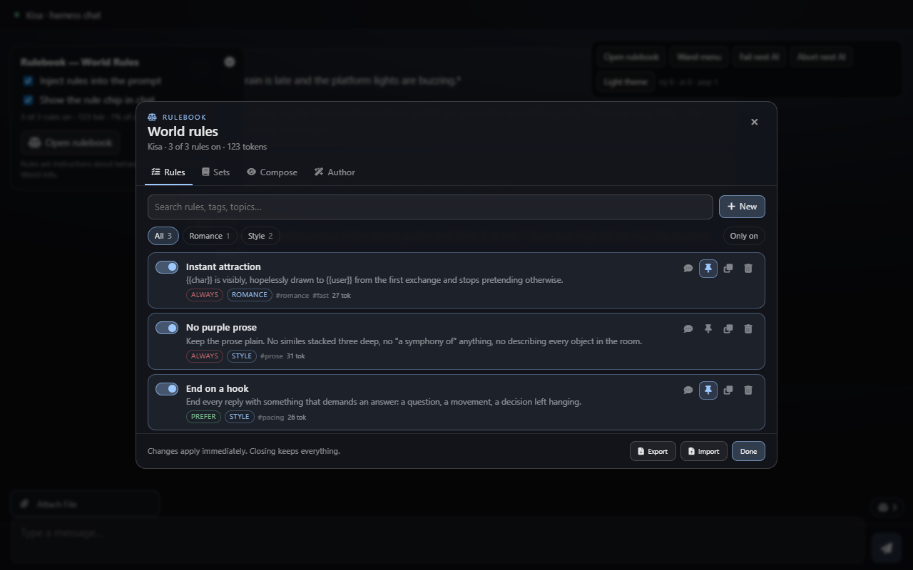
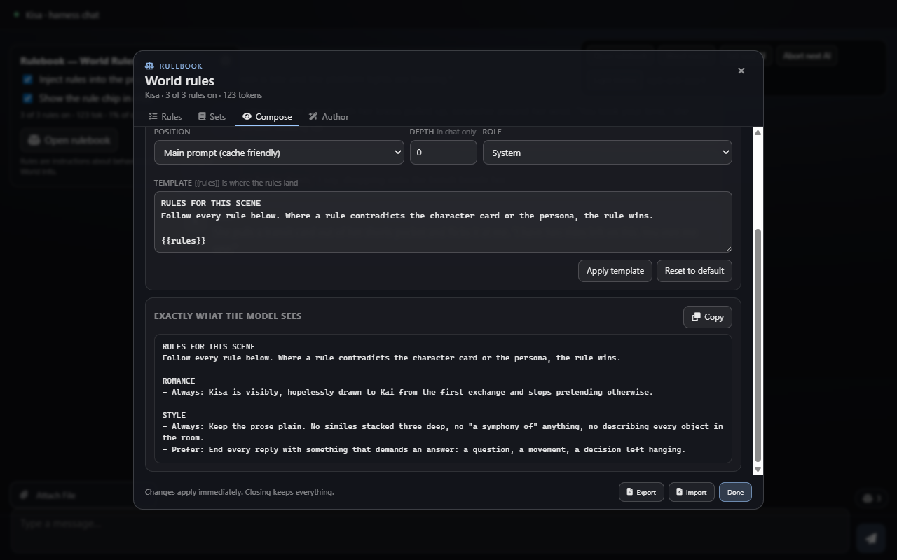
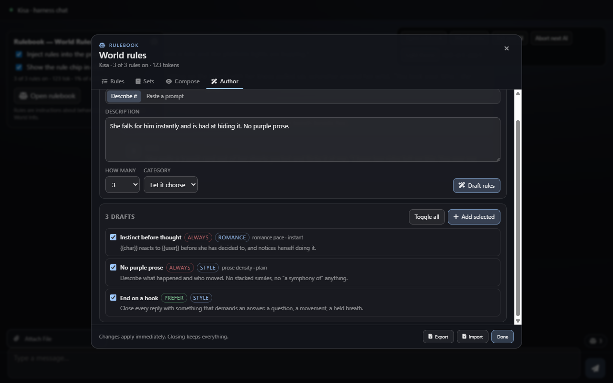
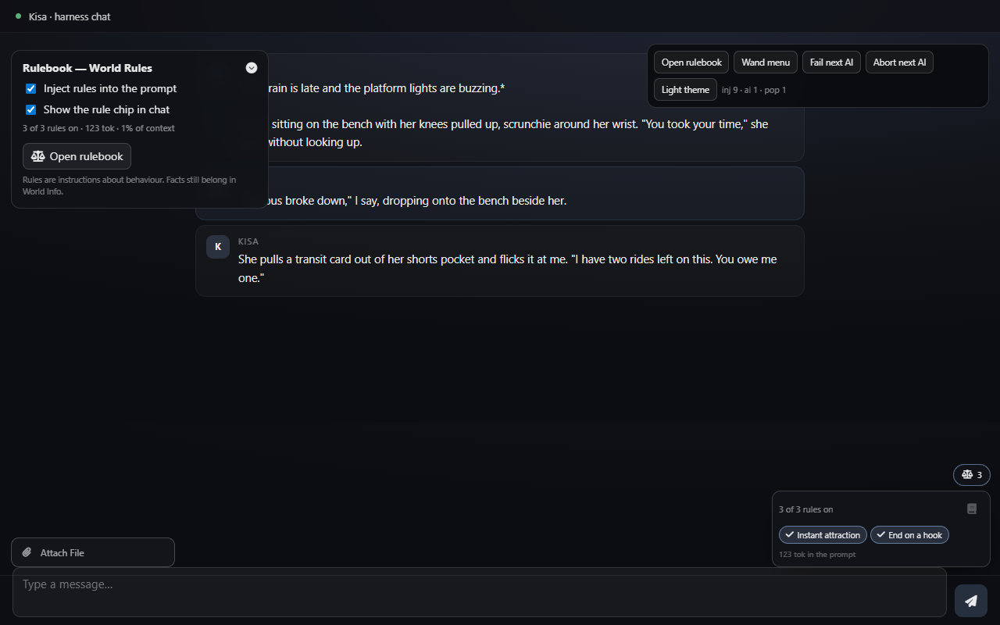
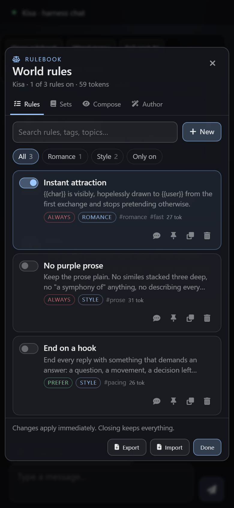

<div align="center">

# Rulebook

**World rules for SillyTavern — every prompt fragment you keep re-pasting, as a switch you can flick.**

Write them, let the AI draft them, group them into sets, override one for a single chat.

[](https://github.com/SillyTavern/SillyTavern)
[](https://github.com/HakaiGod420/st-rulebook/releases)
[](LICENSE)



</div>

---

## The problem

You have a pile of prompt fragments. "She falls for him immediately." "No purple prose." "Never end a scene without
a hook." They live in a notes app, in a Discord message to yourself, in the Author's Note you keep editing, in three
character cards that each carry a slightly different wording of the same idea.

Turning one on means opening the Author's Note, pasting, and remembering to remove it later. Turning four on means
you no longer know what your prompt actually says, or what it costs. And when a character sheet already insists on a
slow burn, your instant-love rule quietly loses — you never find out why.

Rulebook gives each fragment its own object, its own switch and its own line in the budget.

## What it does

- **A library, not a blob.** Every rule is one instruction with a name, a category, a strength and tags. Toggle it
  globally from the list; nothing is pasted anywhere.
- **Always vs Prefer.** `Always` rules read as non-negotiable, `Prefer` rules as a tendency. Strength is expressed in
  words the model actually obeys — there is no hidden weighting, because models do not have weights.
- **The token meter nobody else ships.** The panel shows what the active rules cost, per rule and as a share of your
  context, before you generate a single message. `123 tok · 1% of context` is a number you can make a decision with.
- **Conflicts, caught before the model is.** Give two rules the same topic and a different stance (instant vs slow
  burn) and the panel says so, by name. No group, no false alarm.
- **Sets.** Switch on what you want, save it as *Slow romance* or *Comedy night*, jump between them with one click.
  `Apply` replaces the selection, `Add` stacks on top.
- **Per-chat overrides.** Force one rule on — or off — for the open chat only. The override is stored in the chat's
  metadata, so it survives a reload and travels with the chat file. Emit an override chip and the row says so.
- **An AI that writes rules, not prose.** Describe a vibe in one line and get three atomic, tagged rules back. Or
  paste a two-thousand-word prompt dump and have it split into single rules — the fastest way to convert the pile.
- **Remix.** Take a rule you already have and ask for it softer, harder or sharper.
- **Import / export.** A pack is one JSON file: rules plus sets, deduplicated by text on the way in.
- **Exactly what the model sees.** A Compose tab with the literal injected block, a copy button, and the position and
  depth controls, so debugging is reading rather than guessing.

## Screenshots

**The library** — search, category counts, and a switch on every row:


**Compose** — the block, its cost, and the conflicts in the active set:



**Author** — describe it or paste a dump; nothing is added until you tick it:



**In chat** — pinned rules as chips above the message box:



<p align="center">
  <br>
  <sub>390px viewport — the panel goes full-width, row tools drop to their own line</sub>
</p>

## Install

**From the repo** — *Extensions* → *Install Extension* → paste:

```
https://github.com/HakaiGod420/st-rulebook
```

**Manual** — download [the zip](https://github.com/HakaiGod420/st-rulebook/releases/latest), unzip it, and drop the
`st-rulebook` folder into:

```
SillyTavern/public/scripts/extensions/third-party/
```

Then reload the SillyTavern page (not just the chat).

**Requirements:** SillyTavern 1.12 or newer and any working chat/text-completion connection. Authoring uses
`generateRaw`, so no extra key and no second backend.

## Using it

Three ways in: the **wand menu** → *Rulebook*, *Extensions* → *Rulebook* → **Open rulebook**, or `/rules` to print the
active set.

### Rules

| Control | What it does |
|---|---|
| the switch | turns the rule on or off. Global by default; if the rule is forced for this chat, the switch changes *this chat* |
| chat icon | cycles the per-chat override: follow global → force on → force off |
| pin icon | shows the rule as a chip in the chat HUD |
| row text | opens the editor: name, the rule itself, category, strength, topic + stance, tags |
| copy / bin | duplicate, or delete after confirming |

Rules are written with `{{char}}` and `{{user}}` instead of names, so one rule works across every card. The editor
fills them in from the open chat when it composes the block.

### The rule model

| Field | Why it exists |
|---|---|
| **Strength** | `Always` renders as "Always: …", `Prefer` as "Prefer: …" — the only weighting a model responds to |
| **Category** | groups the injected block and gives the list its filters: Romance, Drama, Conflict, World, Style, Meta |
| **Topic + stance** | the conflict system. Same topic + different stance = your rules disagree, and the panel says which two |
| **Tags** | search. Typing in the search box matches names, text, topics and tags |

### Sets

A set is a saved selection, not a second source of truth — applying one writes the same switches you would click by
hand. `Apply` makes it the only active set; `Add` stacks it on whatever is already on. Save the current selection with
a name; names are matched case-insensitively so you cannot end up with two "Mood" sets.

### Per-chat overrides

Press the chat icon on a row. The override is stored under the chat's own metadata, so:

- it is still there when you reload the chat,
- it is not there in a different chat,
- clearing it puts the rule back under the global switch.

## Where it goes in the prompt

| Position | When to use it | Notes |
|---|---|---|
| **Main prompt** *(default)* | almost always | rules are static, so keeping them in the prefix keeps the prompt cache warm |
| **In chat**, at a depth | when you want the rules closer to the last message | stronger, but every toggle invalidates the cache from that point |
| **Before main prompt** | themes and setups that put their own block first | depth is ignored |

The block is one `.rb` entry through `setExtensionPrompt`. When nothing is active the key is **cleared**, not left
behind — the one bug that makes a chat behave like a different chat.

## Slash commands

```
/rules                              what is on, and what it costs
/rule instant                       toggle it
/rule instant off                   turn it off globally
/rule instant chat-on               force it on for this chat only
/rule instant chat-clear            follow the global switch again
/rulebook                           list the sets
/rulebook Slow romance              apply it (everything else off)
/rulebook add Slow romance          stack it on top
/rulebook save Slow romance         save the current selection as that set
```

Names match exactly first, then by substring, so `/rule instant` finds *Instant attraction*.

## Which model call it uses

| Target | Call | Why |
|---|---|---|
| drafting, splitting, remixing rules | `generateRaw` | the prompts are self-contained: a quiet prompt would build on the **open card**, leaking one character's details into a rule you intend to reuse everywhere |

Both the request and the reply are plain text — the model is asked for a JSON array between `<<<RULES>>>` and
`<<<END>>>`, and the parser tolerates a code fence, a wrapper object, a bare array, or a plain bullet list. A model
that answers in prose gets a readable error instead of silently adding nothing.

## What it deliberately does not do

- **It is not World Info.** Facts belong in World Info; this holds instructions about behaviour. The panel says so on
  every first run.
- **No fake weights.** "Always" and "Prefer" are phrasing, because that is what changes a model's behaviour.
- **No token-counting theatre.** The meter estimates at roughly four characters per token (CJK weighted higher). It is
  a budget, not an invoice.
- **No keyword triggers, no post-generation scrubbing, no per-card rulebooks** — yet. See the roadmap in
  [SPEC.md](SPEC.md).

## Development

The repo ships with a harness that boots the extension against stubbed SillyTavern internals — no SillyTavern
installation needed.

```bash
cd test
python serve.py          # -> http://127.0.0.1:8778/harness.html
```

`serve.py` rebuilds `test/mirror/` from the real sources on every load, so edits appear on reload. The stubs implement
`setExtensionPrompt`, `generateRaw` (returning fenced sentinel JSON, a prose failure mode, and an abort mode),
`chatMetadata`, `saveMetadataDebounced` and the popup shell — enough to exercise every path without a model.

Unit tests for the pure modules (plain node, no dependencies):

```bash
node test/rules.test.mjs
```

### Layout

```
manifest.json      SillyTavern extension manifest
index.js           boot, settings panel, wand menu, injection, chat overrides, slash commands
settings.html      drawer panel in Extensions settings
style.css          all styling, scoped to .rb-root / .rb-hud / .rb-settings
src/rules.js       the model: normalisation, composition, conflicts, sets, import/export
src/generate.js    author / atomize / remix prompts and the tolerant parser
src/ui.js          the modal, the rows, the HUD — no SillyTavern imports
test/              harness, stubs, unit tests, zip builder
docs/              screenshots used above
```

`src/rules.js` and `src/ui.js` import nothing from SillyTavern on purpose: the harness and the unit tests run the exact
same files that ship.

## License

MIT — see [LICENSE](LICENSE).
